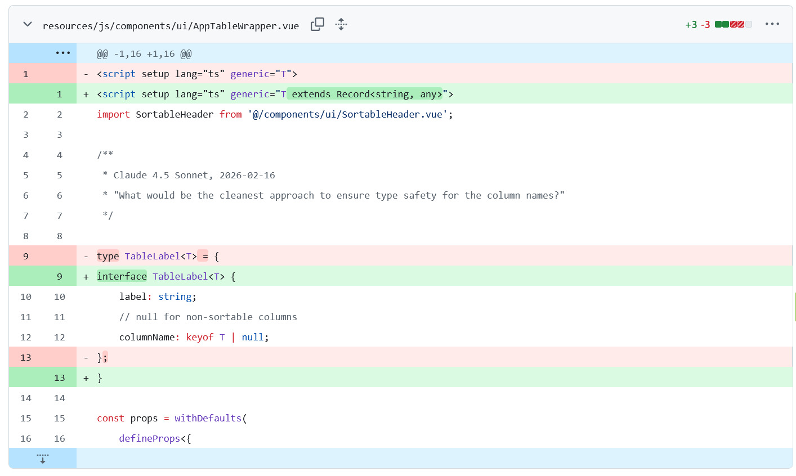

## Mermaid

`->>` -> request message
`-->>` -> return message

## Inertia

### Inertia headers

- result as html or json?
- is an inertia?
- inertia version?

## Architecture

- "high-level" means conceptual overview, not details
- vue composable -> kombinierbar
- encapsulates the full Leaflet map lifecycle -> All the steps needed to create, run, update, and destroy something are handled inside one place

## Config

- wmslayers = {} as const; -> checks for exact content, not just type string

## Eloquent

- Eloquent’s model lifecycle hooks (never completed)

## Misc

method signature = funktionskopf `public function show(param): result`

## Measurement zu Point in Service class

Measurement repräsentiert jedes Datum

## :: vs -> in php

in PHP the :: operator (called the "scope resolution operator") is used to access static methods, static properties, and constants on a class without needing an instance of that class. In contrast, -> is used to access methods and properties on an object instance.

`User::factory()->create();`

## typescript

extends?
type vs interface?

## Presentation Tips

Leute gleich abholen (nicht wie Projektmanagement)

- Was war's Problem?
- Warum haben wir die Arbeit gemacht?
- Was ist das Gesamtbild?
- Technische Details -> wozu?
- Foreshadowing machen
- auf Fragen vorbereiten (passiert selten)
- kein Code durchscrollen (wenn Code, dann ein Snippet, ganz groß in die Slides)
- 20 min (real ~12 min präsentieren)

## Diploma presentation

- technische Details
- Team Lead: 1-2 min Thema vorstellen

## Continuation

### Frage bezüglich Namen

- Im Input-Feld oder CSV?
- Ich könnte die HTML-Entitäten auf die Datenbankeinträge anwenden (&auml; etc)

Und Groß-/Kleinschreibung? Jedes Wort großschreiben? Oder der 1. Buchstabe?

### Nutzerverwaltung

Neu? Keine lokalen Nutzer speichern? Aber Rollen schon noch.  
Soll das auch für Externe gelten? -> Bürgermeister etc
Also nur noch euer System?

OIDC mit JSON wahrscheinlich am sinnvollsten

oidc.userid ist eine Email - sinnvoll als PK? (Email kann sich ändern) -> Wir müssen lokal ja nach wie vor über den Benutzer speichern für Rollen

Welches Claim ist der dauerhaft stabile und eindeutige Identifier eines Benutzers, anhand dessen wir den Benutzer in unserer lokalen Anwendung wiedererkennen sollen? Ist urn:pvpgvat:oidc.userid dafür vorgesehen?

OIDC-Logout? (Aktuell gibt es keinen Logout)

Schritt für Schritt:

- Login bei euch
- Weiterleitung auf unsere Callback-Seite mit Token
- dann mithilfe privatem Schlüssel Token verifizieren
- Daten prüfen (Applikation, Ablauf, ...)
- Benutzer im lokalen System suchen

### Nutzerverwaltung offiziell

Wird euer Portal auch für Externe, d.h. Bürgermeister, interessierte Bürger, etc. gelten? Oder gibt es als Alternativmöglichkeit noch den aktuellen Login?
OIDC mit JSON ist wahrscheinlich am sinnvollsten
Wir brauchen von unserer Seite ein eindeutiges Merkmal, anhand dessen wir den Benutzer identifizieren können. Ist das jetzt die Email? Oder bekommen wir eine (alphanumerische) ID? urn:pvpgvat:oidc.userid enthält laut Beispiel nur die Email.
Und soll es auch einen Logout über OIDC geben? Weil aktuell ist kein Logout implementiert.

### todo

- datei export umlaute, scharfes s parsen
- punkt bearbeiten (projektion, is-visible, measurement löschen, punkt löschen) darf nur admin
- addition (evt aus Messepoche)
- messung bearbeiten
- kommentare
-

### n2h

- Gäste erhalten aktuell immer noch alle Gangliniendaten - ein Datensplit wäre nötig, um das zu verhindern.
